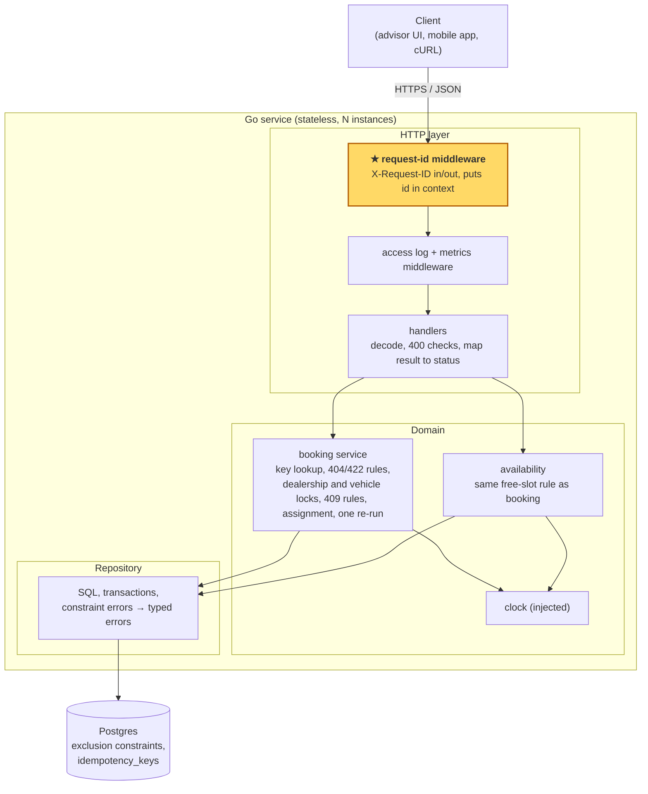

# Design

For a reader evaluating the architecture. Behaviour lives in the [booking spec](superpowers/specs/2026-10-20-booking.md), rules and their reasons in [decisions.md](decisions.md) (D-numbers), API shapes in [openapi.yaml](../openapi.yaml). This file explains how the pieces fit and why; it does not repeat them.

---

## 1. Problem

A dealership books service work by phone and by hand, so the same bay or technician gets double-booked, or a job lands on someone who can't do it.
The advisor needs to know, while the customer is still on the line, which times actually work for this service.
Once a time is confirmed it must hold: a bay and a qualified technician are reserved for the whole job, and nothing else can take them.

### 1.1 What must not happen

A booking system earns trust by never doing a small number of things. This design is organised around those, and the rest of the document is how each one is held. Each row names the failure, the mechanism that prevents it, where to read about it, and the test that proves it. Test names are the spec's example numbers: `N36` is example N36 in the [booking spec](superpowers/specs/2026-10-20-booking.md) and `TestN36` in [spectest/](../spectest/). M is a case that must succeed, N a case that must be rejected.

| Failure | What prevents it | Read | Test |
|---|---|---|---|
| Two cars booked into the same bay, or with the same technician, at the same time | Postgres refuses the second overlapping row (exclusion constraints). The check in Go only explains why; it is not what keeps the calendar correct | §5, D8 | [`TestConstraintsHoldWithoutLocks`](../spectest/concurrency_test.go) (M25 and N36 with both locks off), [`testdb_test.go`](../internal/testdb/testdb_test.go) (direct inserts refused by constraint name); with the locks on, [N36](../spectest/concurrency_test.go) and [M25](../spectest/concurrency_test.go), run 20× in CI |
| One car booked in two places at once | a third exclusion constraint, on the vehicle; and a vehicle lock, so the same car at two dealerships queues instead of racing | §4 step 7, §5, D8 | [`TestConstraintsHoldWithoutLocks`](../spectest/concurrency_test.go) (the same car at two dealerships, locks off: only the vehicle constraint is left to stop it), [`testdb_test.go`](../internal/testdb/testdb_test.go); with the locks on, [`TestVehicleAtTwoDealerships`](../spectest/concurrency_test.go) (the loser gets its 409 from the check, with no deadlock) and [N37](../spectest/concurrency_test.go) (same dealership) |
| A booking confirmed when only the bay or only the technician was free, or when one of them was free at the start but busy later in the job | both must be free for the whole `[start, end)`; the check runs on the full interval, and the constraints use the full interval too | §4 step 7, D6, D7 | [N9](../spectest/conflict_test.go), [N10](../spectest/conflict_test.go), [N11](../spectest/conflict_test.go) |
| A job given to someone who cannot do it | technicians are filtered by the service's required skill before any are considered | §4 step 7, D3, D4 | [N14](../spectest/conflict_test.go), [N15](../spectest/conflict_test.go) |
| A job that runs past closing time, or past the technician's shift | the whole `[start, end)` must fit inside the dealership's hours and the technician's window | §4 steps 6–7, D2, D4 | [N1–N3](../spectest/time_test.go), [N16](../spectest/conflict_test.go) |
| A customer who retries ends up with two appointments | the idempotency key is claimed inside the same transaction as the booking; a retry replays the first answer | §4, D9 | [M15](../spectest/idempotency_test.go), [M17](../spectest/concurrency_test.go) |
| A customer turned away while another bay was free | the dealership lock runs its bookings one at a time, so every check sees the bookings committed before it and a second bay is never lost to a race. The fresh look at the calendar a retry used to give is no longer needed | §4, §5, D8 | [M25](../spectest/concurrency_test.go), [TenRacers](../spectest/concurrency_test.go) |
| A booking saved without its key, or a key saved without its booking | both rows commit or roll back together; nothing is written outside the transaction | §4, §5, D9 | [N38](../spectest/concurrency_test.go) |

Rows 1 and 2 are proved with the locks off. With them on, the lock and the Go check give the same answers, so a test cannot tell whether the constraints work: a grading pass dropped all three and N36, M25 and N37 still passed ([reviews/grading-2.md](reviews/grading-2.md)). Without locks every racer picks the same first bay and technician, so that test proves the bay and technician constraints together; `testdb_test.go` refuses each on its own. N37 books the same bay and technician as well, so the vehicle constraint alone is proved by the two-dealership race.

## 2. Architecture



The request-id middleware (★, highlighted) is the outermost layer, so every log line below it, including the access log, carries the id.

## 3. Components

**Request-id middleware.** Reads `X-Request-ID` or generates one, puts it in the request context and on the response. It must not know about routes, bookings or the database; it is the spot where tracing would plug in later (§7).

**Access log + metrics middleware.** Writes one log line per request in and out, and records the two booking metrics (§7). It must not know why a booking failed beyond what the handler puts on the context; the reason is logged by the domain.

**Handlers.** Decode JSON, run the 400 checks (missing fields, types, offset on `start`, key format), call the domain, and turn the domain result into a status code and body. They must not know about bays, technicians, hours or SQL. All they know is "domain returned created / conflict(reason) / invalid / not found / unavailable".

**Booking service (domain).** Owns the check order after 400 (key lookup → 404 → 422 → dealership lock → vehicle lock → 409), the assignment rule (D7), and the one defensive re-run (D8). It reads time only from the injected clock. It must not know about HTTP status codes, headers or SQL error codes; it sees `ErrBayTaken`, `ErrTechnicianTaken`, `ErrVehicleBusy` from the repository, not SQLSTATE `23P01`.

**Availability (domain).** Answers `GET /availability` with the same "is this bay / technician free for `[start, end)`" rule the booking uses, so the list and the booking cannot disagree (spec rule 12). It must not know about vehicles or idempotency.

**Clock.** One interface, `Now()`. Production uses the wall clock; tests fix it (D12). The one exception is the access and metrics middleware, which calls `time.Now()` to time a request: a duration for the log and the latency histogram, never a booking decision.

**Repository.** Runs SQL, owns transaction start/commit/rollback, and translates constraint violations into the typed errors above by constraint name. It must not know the business rules: it doesn't decide which bay comes first or which 409 reason wins; it only returns rows and errors. The transaction travels in the context, so the repository need not import the service package that declares its interface. The cost: a call made with the wrong context is outside the transaction. Mitigation: `InTx` is the only place a transaction starts, and every write (the key claim and save, both locks, the insert) takes the transaction from the context and returns an error if there is none, so a wrong context fails at once instead of running on the pool. The tests could not show this: in them the repository's base DB is already the test transaction, so a wrong context would still have run inside one. `TestWritesNeedTransaction` calls each write with a bare context.

**Postgres.** Holds all state. Its exclusion constraints are the last word on overlaps (§5).

**Replay body.** The idempotency key row stores the domain result (created appointment or conflict reason) as JSON, not an HTTP response. The handler renders it with the same code on the first response and on every replay, so the bodies match and HTTP stays out of the domain.

## 4. Data flow: `POST /appointments`

Happy path, with a key:

1. Request-id middleware sets the id. Access middleware logs the request in and starts the latency timer.
2. Handler decodes and validates the body. Malformed → **400**, nothing touched in the DB.
3. Domain opens a transaction; its first statement sets `lock_timeout` to 1 s, so every lock wait from here on is bounded (D8). It inserts the key row (`key`, `request_hash`, `created_at`). If another request holds the same key, this waits on its lock (D9; 1.1 row 6), for at most 1 s; longer → **503** with `Retry-After: 1`.
4. No existing row (or one older than 24 h) → continue as new.
5. Domain loads dealership, vehicle, service type. Unknown → **404**, rollback (key row goes too).
6. Domain checks the request against the rules: aligned, `start > now`, inside hours, service type belongs to dealership. Fails → **422**, rollback (1.1 row 5).
7. Domain reads the dealership's bays and qualified technicians, then takes the dealership's advisory lock and then the vehicle's, with or without a key. Both are held until commit or rollback, so from here to the commit the dealership's bookings, and the vehicle's bookings at any dealership, run one at a time (§5); a 404 or 422 never waits on them. A wait past `lock_timeout` (1 s) on either → **503** with `Retry-After: 1`, no re-run. The order is always key (step 3), dealership, vehicle, so no two bookings can wait on each other in a cycle (D8). Then the domain checks the vehicle, then bays, then technicians, using the rules in D4–D7 (1.1 rows 3–5). First failure becomes the 409 reason.
8. Domain picks the first free bay and first free qualified technician by id and inserts the appointment. The locks leave it no other booking's row to wait on.
9. Domain writes the result onto the key row and commits. Key row and appointment land together (1.1 row 8).
10. Handler returns **201**. Access middleware logs the result and records metrics.

**409 path.** Step 7 finds a blocker (`vehicle_busy`, `no_bay` or `no_technician`). The domain writes the 409 result onto the key row and commits the key row alone. Handler returns **409** with the reason. A retry with the same key replays the same 409.

**Defensive re-run path.** A booking cannot reach it. Within one dealership, the dealership lock means no other booking inserts between this one's check and its insert. The same vehicle booked at two dealerships at once holds two different dealership locks, but the second booking waits on the vehicle lock, then reads the first's committed row at step 7 and gets 409 `vehicle_busy` from its check, with no insert. What is left is a code path that skips the locks, or a mistake in them. If an insert still hits a constraint or a deadlock:

1. Postgres aborts the loser's transaction; everything in it, including its key row, is gone.
2. Repository maps the violation to `ErrVehicleBusy` (or `ErrBayTaken`, `ErrTechnicianTaken`), or a deadlock to `ErrDeadlock`.
3. Domain waits a short random 50–100 ms, then starts a new transaction and re-runs once from step 3. That is a full second attempt, with its own key claim, locks, checks and insert, and each wait bounded by `lock_timeout` again, not just the backoff. By then the other booking has normally committed, so the fresh check at step 7 returns `vehicle_busy` and stores it on the key row like any other 409.
4. If the re-run hits the vehicle constraint again, the domain returns **409** `vehicle_busy` without storing it. Any other violation or deadlock on the re-run → "unavailable": handler returns **503** with `Retry-After: 1`. Nothing is stored, so the client's retry with the same key runs as new. Never 500.

A side effect worth knowing: while A waits for its re-run, its key row doesn't exist. A same-key request B that was waiting on it runs as new, and A's re-run then waits on B's key row and replays B's result. The outcome is still one booking per key.

**Idempotent replay path.** Step 3 finds a committed, fresh key row.

- Same `request_hash` → return the stored status and body (201 or 409). No 404/422/409 checks run. That's why a replay still works after `start` has passed (spec M18).
- Different hash → **422**.
- Either way, `X-Request-ID` on the response is the current request's, not the original's.

Without a key, the key claim in steps 3–4 and the key write in step 9 are skipped. The dealership lock in step 7 is still taken; the rest is the same.

If the 5 s request deadline passes during any wait, the domain returns "unavailable" with `reason=deadline`: rollback, **503** with `Retry-After: 1`, nothing stored. The waits are bounded one by one, but they can add up, so the deadline is the real bound (D8). Any other error (lost connection, a failing query) → rollback, **500**, nothing stored.

## 5. Data model

Reference data (seeded, D11):

| Table | Key columns |
|---|---|
| `dealerships` | `id`, `timezone` (IANA), `open_time`, `close_time` |
| `skills` | `id` |
| `bays` | `id`, `dealership_id` |
| `technicians` | `id`, `dealership_id`, `work_start`, `work_end` |
| `technician_skills` | `technician_id`, `skill_id` (FK to `skills`) |
| `service_types` | `id`, `dealership_id`, `duration_minutes`, `required_skill` (FK to `skills`) |
| `customers` | `id` |
| `vehicles` | `id`, `customer_id NOT NULL` |

Check constraints keep durations and hours on the 15-minute grid (D1).

Bookings:

| Table | Columns |
|---|---|
| `appointments` | `id`, `dealership_id`, `customer_id`, `vehicle_id`, `service_type_id`, `bay_id`, `technician_id`, `start`, `end`, `status` |
| `idempotency_keys` | `key` (PK), `request_hash`, `status`, `body`, `created_at` |

The three exclusion constraints on `appointments`, each partial `WHERE status = 'confirmed'` (1.1 rows 1–3):

```sql
EXCLUDE USING gist (bay_id        WITH =, tstzrange(start, "end") WITH &&)
EXCLUDE USING gist (technician_id WITH =, tstzrange(start, "end") WITH &&)
EXCLUDE USING gist (vehicle_id    WITH =, tstzrange(start, "end") WITH &&)
```

`tstzrange` defaults to `[)`, which is the half-open rule from D6. Equality on a text id inside a gist index needs the `btree_gist` extension. The gist indexes that back these constraints also serve the "who is busy between X and Y" reads.

`idempotency_keys` uses the primary key as the lock: a second insert of the same key waits until the first transaction ends (1.1 row 6).

**Why the database is the final guard.** The dealership lock makes a booking's check and insert take turns, but only for code that takes it. Any code path that does not, now or later (a bulk import, a reschedule), could read a free bay and insert over another booking, and an in-process lock wouldn't help once there are two instances. Across dealerships the dealership locks differ, so only the vehicle lock queues one car's bookings, and it too covers only code that takes it. The exclusion constraint closes all of these: Postgres rejects the second overlapping row no matter which instance or code path wrote it. The domain check is still there, but its job is to produce a clear 409 reason, not to keep the calendar correct. Reasoning and alternatives: D8.

**Why there are also locks.** The constraint alone keeps the calendar correct but not live. Concurrent inserts that clash on an exclusion constraint each wait on the other's uncommitted row and deadlock; under contention they deadlock in chains, Postgres breaks one cycle per second, and losers ran past the request deadline into 500s (`ceb8c6d`). So the booking takes two advisory locks after the 404 and 422 checks, before the availability reads: the dealership's, then the vehicle's. A dealership's bookings then run one at a time, each check sees every booking committed before it, and the 409 it gives is the final answer. The vehicle lock is for the one car booked at two dealerships: each booking holds a different dealership lock, so their inserts waited on each other's uncommitted vehicle row and could deadlock, and Postgres takes about a second to abort one while that booking still holds its dealership lock, so unrelated bookings queued behind it could get 503 (grading pass 2). With the vehicle lock the second booking waits for the first to commit and reads its row. Both kinds are needed: the locks only cover code that takes them, so they can't be the correctness guard; the constraint can't be bypassed, but on its own it deadlocks under load. The locks are the liveness guard, the constraint the correctness guard. The order is fixed (key, dealership, vehicle), so the locks cannot form a cycle, and the one re-run in §4 stays as a defence.

The transaction runs at Postgres's default `READ COMMITTED`. Correctness doesn't depend on a stricter level, because the constraints catch what the isolation level lets through.

## 6. Tech choices

**Go.**
- Why: one static binary, `net/http` and `log/slog` in the standard library, cheap to run several instances.
- Considered: I'm familiar with Go, and it is the stack I can defend deepest in review. The parts that matter here (transactions, constraints, concurrency) are language independent, so another language would not change the design.
- Switch when: the team that owns this is fluent in something else. The design carries over.

**Postgres.**
- Why: exclusion constraints on ranges. They turn "no overlapping bookings" into a rule the database enforces, which is the core of the problem. Few databases have this.
- Considered: MySQL, which has no exclusion constraints. There are three ways to hold the overlap invariant there:
  - Row locks: `SELECT … FOR UPDATE` on the bay, technician and vehicle rows, check overlap, then insert. Correct but procedural: any code path that skips the lock breaks the invariant. This is exactly what D8 rejected.
  - Slot table: materialise 15-minute slots, `UNIQUE (resource_id, slot_start)`, one row per slot per booking (OIL = 2 rows). An overlap becomes a duplicate key, so the guard stays declarative like the exclusion constraint. Only possible because D1 fixed the slot grid. Cost: N rows per booking, and availability reads change shape.
  - Advisory lock per dealership (`GET_LOCK`): simplest, but it serialises the whole dealership instead of one resource, and without a constraint behind it, it would be the correctness guard, which any code path that skips it breaks. The Postgres design takes the same lock, but only as the liveness guard (§5).

  On MySQL I'd pick the slot table. The decision is about keeping the invariant declarative, not about the database.
- Switch when: the platform standardises on MySQL. The slot table is the migration path, and the domain layer does not change.

**Exclusion constraints as the overlap guard.**
- Why: declarative; no future code path can skip them (D8).
- Considered: `SELECT … FOR UPDATE` on bay and technician rows; an application mutex (D8).
- Switch when: a rule a constraint can't express shows up, e.g. "a technician does at most N jobs a day". Then I'd lock the technician row in the transaction, and keep the constraints for overlaps.

**Idempotency keys in the same Postgres database.**
- Why: the key row and the appointment have to commit or roll back together. That only works if they're in the same transaction.
- Considered: Redis with a TTL. It's faster, but it can't share a transaction with the booking, so a crash between the two writes leaves a booking without its key, or the other way round.
- Switch when: not while bookings live in Postgres.

**Per-dealership and per-vehicle locks, one defensive re-run, then 503 with `Retry-After: 1`** (D8).
- Why: the dealership lock makes a dealership's bookings queue instead of race, so a check is never stale and no booking is turned away while another bay was free. Without it, inserts that clash on a constraint deadlock in chains under contention (`ceb8c6d`). The vehicle lock does the same for one car at two dealerships. The one re-run, after a 50–100 ms jittered backoff, is a defence for a violation the locks should have prevented; it is a full second attempt, not just the backoff.
- Considered: constraints alone with up to 3 retries, the original design (deadlocked under contention); 409 on the first violation (wrong answer when another bay was free); a dealership lock only, with a 2 s `lock_timeout` on the insert so the deadlock detector aborts one side (the cross-dealership race still held a dealership lock for about a second).
- Switch when: one dealership saturates its lock, i.e. bookings there queue long enough to show in `booking_latency_seconds`. Then lock per resource (each candidate bay and technician, in id order) instead of per dealership.

**slog + two metrics, no tracing SDK** (D13).
- Why: one log line per decision is enough to explain any rejected booking; two metrics cover "failing" and "slow".
- Considered: full OpenTelemetry (D13).
- Switch when: there is more than one service in the request path, or a tracing backend someone actually reads.

**Router: standard `net/http` mux.**
- Why: method + path patterns are enough for three routes; no dependency.
- Considered: `chi`.
- Switch when: middleware per route group gets messy.

**DB driver: `pgx`.**
- Why: it exposes the constraint name on errors, which the repository needs to tell bay, technician and vehicle violations apart. The repository also caches `time.LoadLocation` per timezone name, so a booking does not reload its dealership's zone. The pool uses `QueryExecModeCacheDescribe`, so it names no prepared statement (§8).
- Considered: `database/sql` + `lib/pq`.
- Switch when: not expected.

**Migrations: `goose`, plain SQL files.**
- Why: the schema is mostly constraints and extensions (`btree_gist`), which are clearest as SQL. `goose` just runs numbered files in order.
- Considered: `golang-migrate`; an ORM's auto-migration (hides the constraints this design depends on).
- Switch when: not expected.

**Postgres in tests: Docker Compose.**
- Why: the (pg) tests need a real Postgres for the exclusion constraints and key locks. One `docker compose up` serves both local runs and CI.
- Considered: testcontainers (starts a container per test run from Go code).
- Switch when: CI can't run Compose, or tests need a fresh database per package.

**Metrics: Prometheus text format** on `/metrics`.
- Why: the de facto format; every metrics backend can scrape it.
- Considered: pushing to CloudWatch directly.
- Switch when: moving to OpenTelemetry (§7).

## 7. Observability

**Request id.** Set by the outermost middleware, echoed in `X-Request-ID`, and attached to every log line through the context. A replay carries the current request's id, so a retried call can be followed on its own (D9).

**Log convention** (D13). Structured JSON via `slog`. Every line has `request_id`, `method`, `path`, plus `dealership_id` once known. Logs only at boundaries:
- request in, request out (status, duration);
- each domain decision with its reason (e.g. `result=conflict reason=no_technician`, `result=retry` before the re-run);
- each DB error.

No logging inside loops or helpers. The test for the convention: any rejected booking can be explained from its lines alone.

**Metrics.**
- `booking_attempts_total{result}`: one count per `POST /appointments`, `result` one of `created`, `replayed`, `conflict`, `invalid`, `unavailable`, `error` (D13). The 409 reason stays in logs, not in a label.
- `booking_latency_seconds`: histogram of the whole request, time waiting on the locks and the re-run included.

**What I'd alert on.**
- `error` + `unavailable` as a share of all attempts, above a threshold for 5 minutes. Bookings are failing for reasons that aren't the customer's.
- p95 `booking_latency_seconds` above a threshold for 5 minutes. Usually the database.
- No `created` at all for 30 minutes during opening hours, when there were attempts. Catches the quiet failures, e.g. a clock bug that makes everything 422.

I don't have thresholds yet; they need a baseline from real traffic. 409s are not an alert: a full workshop is a business fact, not an outage. It belongs on a dashboard.

**Later, OpenTelemetry:** the request-id middleware becomes the span-starting middleware, the request id becomes (or links to) the trace id, and the two metrics move to OTel instruments with the same names.

## 8. Scale & reliability

Rough sizing for 1000 dealerships, ~10 bays each, ~15 jobs per bay per day: about 150k bookings a day, under 10 writes a second at peak. Writes are not the problem. Each overlap check touches one dealership's day, and the constraints only conflict within one bay, technician or vehicle. These numbers are estimates, not measurements.

**What breaks first, in my expected order:**

1. **Availability reads.** Clients call `GET /availability` far more than they book, often once per date they show. One query per candidate start time would be ~35 queries per call. Built, not future: availability loads the dealership's bays, technicians and that day's appointments once and computes the free starts in memory, with the same function the booking uses (`PickResources`).
2. **Database connections.** Several instances × a pool each runs into Postgres's connection limit before CPU. Change: small pools, plus a pooler (PgBouncer or RDS Proxy) in transaction mode. Pooler-safe here means no named prepared statements and no startup parameters. The first: `repository.Connect` builds the pool with pgx's `QueryExecModeCacheDescribe`, which caches a statement's description and runs it unnamed; the default mode prepares a named statement per connection, which a transaction-mode pooler would hand to another client (`TestConnectPreparesNoNamedStatements` fails on the default). The second: `Connect` passes no runtime parameters, so there is nothing for PgBouncer to reject (a `statement_timeout` startup parameter was removed for that reason, `b24f9c4`); `lock_timeout` is `SET LOCAL` inside each transaction, and the request deadline travels in the context.
3. **`idempotency_keys` growth.** Without cleanup, expiry would be lazy (an old row is overwritten only when the same key comes back) and most rows would stay forever. Already planned (D9): a periodic `DELETE … WHERE created_at < now() - interval '24 hours'`, run as a scheduled task outside the service (ECS scheduled task or cron; locally a make target). Not a loop in each instance: N instances would run it N times. At this volume that is ~150k rows a day, a small delete. If it ever isn't, batch the delete or partition the table by day and drop old partitions.
4. **`appointments` grows forever.** Fine for years at this volume: the overlap reads (`ListBusy`, `VehicleHasOverlap`) are served by the GiST indexes behind the exclusion constraints (grading pass 2 ran EXPLAIN over 105k rows and the planner used `appointments_vehicle_excl`). Change, much later: partition by month, or move past appointments to an archive table.
5. **Hot dealership contention.** Each dealership is serialised: the availability read inside the booking (not `GET /availability`, which takes no lock) and the insert take one lock and run one booking at a time. There is no benchmark of what that costs, and none is claimed. By the sizing above a dealership books about 150 jobs a day, so its lock is contended by a burst, not by the average, and dealerships don't share a lock, so adding dealerships doesn't make it worse. A booking can also wait for a vehicle's lock while holding its dealership's, when another dealership is booking the same car; that wait ends when that booking commits, and `lock_timeout` bounds it. The cost to watch: a booking waiting on a lock holds a pool connection. A blocked dealership holds its waiters for one `lock_timeout` window (1 s), and how many wait at once is bounded by the pool size, so a hot dealership can fill a shared pool and starve the others. Mitigation, out of scope: a pool per dealership, or a queue in front of booking. Change, if one dealership's lock wait shows in latency: lock per resource (§6).

I would not add a cache for availability. The point of "real-time" in decisions.md §0.3 is that the answer reflects the database at request time, and the reads above are cheap once batched.

**AWS deployment.** The service runs as a container on ECS Fargate, two or more tasks across availability zones, behind an Application Load Balancer that health-checks a `/healthz` endpoint. Postgres is RDS for PostgreSQL, Multi-AZ, with `btree_gist` enabled. RDS supports it, so the exclusion constraints carry over unchanged. DB credentials come from Secrets Manager. Migrations run as a one-off ECS task before the new version takes traffic; the `idempotency_keys` cleanup runs as an ECS scheduled task. Graceful shutdown (D12) should finish in-flight requests within the ALB's deregistration delay. Logs go to CloudWatch Logs as JSON. Metrics are scraped from `/metrics` into Amazon Managed Prometheus. Because the service holds no state, scaling is just changing the task count; the limit is the database, which is what items 1–2 above address.

## 9. Out of scope

See [decisions.md §3](decisions.md#3-out-of-scope-deliberate).

## 10. How GenAI was used in design

The rule for the design phase was that I decide and the AI challenges. I wrote decisions.md myself before the AI saw it (`3dc31d7`), then gave it to a challenger agent, which raised 16 points ([reviews/decisions-challenge.md](reviews/decisions-challenge.md)), each logged with my verdict in [decisions.md §5](decisions.md#5-challenge-log). It found that D8 guarded bays and technicians against overlap but not the vehicle, so the vehicle became the third exclusion constraint (decisions.md §5 #1). It also argued that first-by-id assignment can spend a scarce skill on a job anyone could do; I kept the rule and recorded the cost in decisions.md §3 instead (decisions.md §5 #6).

The spec was then written as examples, not prose, with the AI, from my seed data and my key cases ([booking spec](superpowers/specs/2026-10-20-booking.md)). Each example was written to become one test, and later did. Concrete Given / When / Then rows exposed what prose had let me skip: nothing said which 409 reason wins when the bay and the technician are both busy, which is now `no_bay` ([decisions.md §6](decisions.md#6-spec-review-log) #1). The technician's own hours had no rule saying they were checked, and the seed was changed so the rule could be tested, with T2 ending at 13:00 (decisions.md §6 #11).

The spec was red-teamed twice, each time by an agent in a new session with a clean context that got only the spec and `openapi.yaml`, with no code and no discussion ([reviews/README.md](reviews/README.md)). A clean context matters because an agent that watched a rule being argued out tends to accept it, while one that sees only the contract tests what it actually says. Pass 1 ran before the spec was frozen and raised 20 points: 17 went into the spec or decisions (`24776f8`), 2 were ruled out of scope and 1 was deferred ([reviews/red-team-1.md](reviews/red-team-1.md)). Pass 2 ran 19 cases with curl against the running server and found 3 bugs (`cb3d5ce`, `36de09c`, `f86ea32`), one spec wording error and five input rules that went into D9 (`2b8d9be`, [reviews/red-team-2.md](reviews/red-team-2.md)).

Review was a separate role too: each PR was reviewed by a clean-context agent that had not written the code, given the spec, decisions, design, plan and diff ([reviews/README.md](reviews/README.md)). From PR #11 on its full output is kept with my verdict on every point; for PRs #1–#10 only the findings I took survive, as the 15 `fix(ai):` commits ending "caught in PR review". It was right that pgx sent `statement_timeout` as a startup parameter, which PgBouncer rejects, so this document's §8 claim that a transaction-mode pooler works no longer held: the code broke the claim and review caught it (`b24f9c4`). The implementer pushed back with evidence twice and won: when the reviewer called decisions.md §5 #2 inaccurate, it argued to keep the status check as the last guard against a typo, and I agreed and reworded decisions.md §5 #2 instead (`2377381`); and when I ruled that any printable `X-Request-ID` should be accepted, it showed the rule had been `[A-Za-z0-9._-]{1,128}` since `923427d` and in `openapi.yaml`, and I withdrew the ruling ([reviews/red-team-2.md](reviews/red-team-2.md) #19). The rest of the build-phase story is in the [README](../README.md#ai-collaboration).

The last pass was on this document: an interview-question pass asked what a senior engineer would put to this design, and the question of what changes on MySQL, which has no exclusion constraints, became the three alternatives and the slot-table choice in §6 Tech choices above (`54313f5`). Counted from [docs/reviews/](reviews/README.md) and the git log, the decisions challenge and red-team pass 1 raised 36 points, of which I accepted 32, overruled 3 (one kept, two ruled out of scope) and deferred 1; pass 2 ran 19 cases and found 3 bugs; PR review led to 15 fixes; and the implementer overruled the reviewer once (the status check) and me once (`X-Request-ID`, red-team pass 2 #19). What I'd change: this document's §8 claimed that nothing relies on session state and nothing checked it until code review, and it was wrong a second time, about named prepared statements, until grading pass 2, so next time every claim in §7 Observability and §8 Scale & reliability of this document gets a check, the way `make layers` checks the import rule, or is marked as an estimate.

A grading pass then compared the code with this document and decisions.md and found they had drifted at the headline decision: after `ceb8c6d` the code took a per-dealership lock after the checks, kept the three-attempt retry loop, and no document mentioned the lock. The fix was to change the design, taking the lock first in the transaction and cutting the retries to one re-run, and then the documents to match, not the documents alone (`ed17c38`). PR review on that fix then moved the lock after the 404 and 422 checks, so a rejection never waits on it, and bounded the wait with `lock_timeout` (`8d23da7`). The chain did not stop at one fix: the grading pass led to a redesign (`ed17c38`), two PR reviews tightened it (`8d23da7`, `48a739e`), and the second review's 1 s lock timeout, equal to Postgres's deadlock timeout, made a cross-dealership race fail one run in sixty in `make races`. That failure became the rule in D8 that any wait which can deadlock needs a `lock_timeout` longer than `deadlock_timeout`, or both sides lose (`6b6604c`). The next grading pass showed the rule had only moved the problem: the same car at two dealerships still waited about a second for the detector while holding a dealership lock. The fix was to remove the wait that could deadlock, not to tune it: a vehicle lock taken after the dealership lock (`9acdacd`).

A second grading pass listed 15 unbacked claims, 4 of them real bugs reachable from the public API. Opening hours were midnight plus a duration, so a New York dealership opened at 09:00 on the day the clocks went forward while the docs said DST was handled (`c5ae52a`). The request hash dropped fractional seconds, so the same key with a different `start` replayed the first answer instead of a 422 (`bba499f`). pgx's default statement cache uses named prepared statements, which a transaction-mode pooler breaks, while §8 said nothing relied on session state (`e172829`). And the same car booked at two dealerships could deadlock while holding a dealership lock (`9acdacd`). Among the other claims was the table in §1.1: it cited tests that still passed with the exclusion constraints dropped, because the lock and the Go check give the same answers. The fix was a test that turns the locks off, so the constraints are the only guard left. Every verdict, including the points I did not take, is in [reviews/grading-2.md](reviews/grading-2.md).
